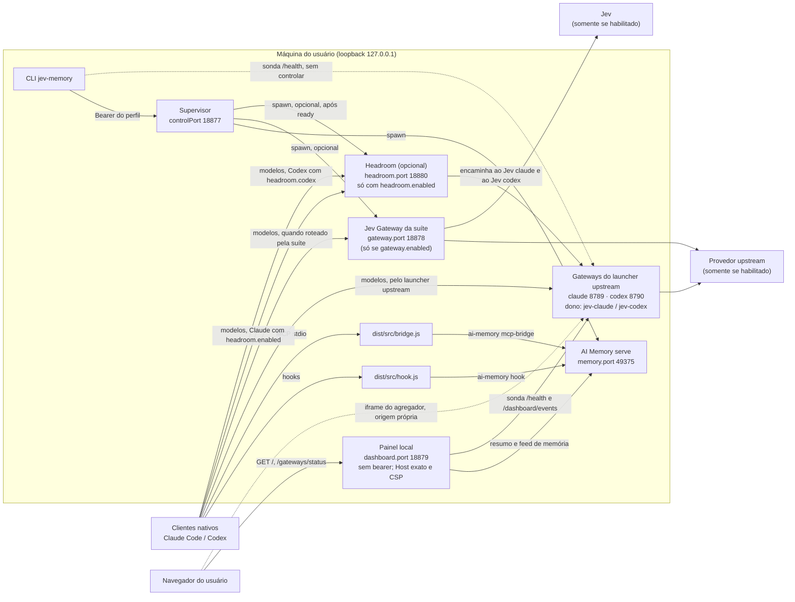
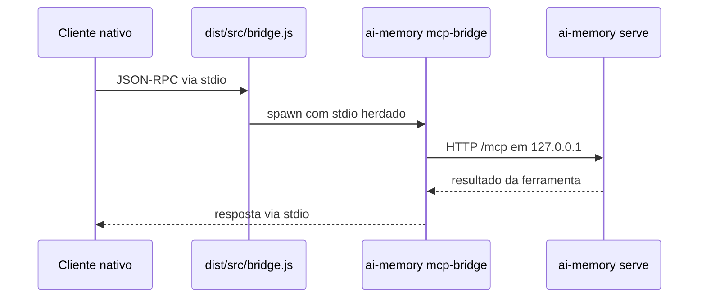

# Arquitetura

Propósito: descrever componentes, fronteiras de confiança, fluxos de processo, captura de hooks, consulta MCP, busca semântica local, migração do histórico, gateways, Headroom (opcional, Claude e Codex), reinício do supervisor e o layout de dados locais. Público: mantenedores e revisores de segurança. Data: 2026-10-23.

## Componentes

| Componente | Arquivos | Responsabilidade |
|---|---|---|
| CLI | `bin/jev-memory.mjs`, `src/cli.ts` | Comandos e seleção de perfil (`--profile`) |
| Ciclo de vida | `src/lifecycle.ts` | `init`, `start`, `stop`, `status`, `doctor` e `config` |
| Supervisor | `src/supervisor.ts` | Processo destacado que dona apenas os filhos que cria, reinicia um filho que cai depois de pronto (até 3 vezes em 60 s) e expõe `/status` e `/stop` |
| Gateways upstream | `src/gateways.ts` | Lê as portas dos gateways do launcher upstream (claude 8789, codex 8790) da instalação, sonda `/health` e lê as contagens de `/dashboard/events` somente em loopback. Não inicia nem para o gateway ([ADR 0009](adr/0009-gateway-ownership-and-recovery.md), [ADR 0010](adr/0010-unified-dashboard.md)) |
| Painel local | `src/dashboard.ts`, `src/dashboard-page.ts`, `src/dashboard-script.ts`, `src/dashboard-style.ts`, `src/gateways.ts`, `src/gateway-metrics.ts`, `src/gateway-history.ts`, `src/gateway-views.ts` | Página em `dashboard.port` (18879) com a memória do AI Memory, um iframe do agregador do Jev Gateway e a observabilidade de tokens do histórico do log ([ADR 0010](adr/0010-unified-dashboard.md), [ADR 0011](adr/0011-native-dashboard-and-token-observability.md)) |
| Instalação | `src/install.ts` | Build versionado dos motores e ponteiro `current.json` |
| Atualização | `src/update.ts` | `git subtree pull --squash` com registro em `upstream.updates.json` |
| Configuração | `src/config.ts`, `config/default.json` | Schema estrito (zod) e caminhos locais validados |
| Hooks | `src/hook.ts` | Validação do payload nativo antes de chamar `ai-memory hook`; 9 eventos no Claude e 7 no Codex |
| Modelo local | `src/models.ts` | Verificação por sha256 e provisionamento do modelo de embeddings por perfil ([ADR 0007](adr/0007-local-semantic-memory.md)) |
| Migração | `src/migrate.ts`, `src/migrate-*.ts` | `migrate-history`: importação aditiva do histórico da instalação original ([ADR 0008](adr/0008-history-migration.md)) |
| Bridge MCP | `src/bridge.ts` | Ponte stdio para o `ai-memory mcp-bridge` |
| Diagnóstico MCP | `src/mcp.ts` | Cliente de handshake e `memory_status` com allowlist de métodos e ferramentas |
| Clientes | `src/clients.ts` | Registro transacional em Claude, Codex e Codex Desktop |
| Lançamento | `src/launch.ts` | Executa Claude ou Codex com configuração específica do perfil |
| Headroom (opcional; Claude e, com `headroom.codex`, Codex) | `src/headroom.ts`, `startHeadroom` e `codexHeadroom` em `src/supervisor.ts`, `prepareHeadroom` e `buildCodexHeadroomSpawn` em `src/launch.ts`, `patches/headroom/0.41.0/jms_headroom_shim.py` | Localiza o executável e confere a versão fixada, inicia o proxy depois de `ready` (com o shim do Codex, quando ligado) e roteia `jev-memory-claude` e `jev-memory-codex` por ele, com fallback antes de o cliente iniciar ([ADR 0013](adr/0013-headroom-context-compression.md), [ADR 0014](adr/0014-headroom-codex-routing.md)) |



## Fronteiras de confiança

1. **Conta do usuário e sistema de arquivos.** Todos os processos rodam sob a conta do usuário. A proteção de `.local/` depende das ACLs do NTFS, porque o Windows ignora os modos POSIX (`0600`).
2. **Loopback.** Supervisor, Gateway e AI Memory escutam em `127.0.0.1`. Outro processo da mesma conta pode tentar conectar; o bearer por perfil é a barreira.
3. **Entrada dos clientes nativos.** Hooks e MCP recebem dados que a suíte trata como não confiáveis. Payloads são validados antes de qualquer leitura de configuração.
4. **Conteúdo da memória.** Páginas e observações recuperadas são dados históricos, não instruções. A suíte não as executa; o risco de injeção permanece para o cliente e o operador (veja [threat-model](../security/threat-model.md)).
5. **Provedores externos.** Só existem se o Gateway estiver habilitado. Os hosts devem estar na allowlist e usar HTTPS (ou loopback numérico).
6. **Arquivos de cliente no workspace.** `.mcp.json`, `.codex/*` e `.claude/settings.local.json` são alterados somente com propriedade comprovada e backup.

## Processos e fluxo de inicialização

```mermaid
sequenceDiagram
  participant U as CLI
  participant S as Supervisor (destacado)
  participant M as ai-memory serve
  participant G as Gateway (node dist/index.js)
  U->>S: spawn de dist/src/supervisor.js
  loop até 45 s
    U->>S: GET /status com Bearer
  end
  S->>S: verifica que as portas estão livres
  S->>S: initMemory (cria config em diretório novo; sincroniza embedding_provider)
  S->>S: ensureLocalModel (somente se memory.semanticSearch)
  S->>M: spawn com --bind 127.0.0.1:memory.port
  S->>M: GET /healthz
  S->>G: spawn com env allowlist e chaves do ambiente
  S->>G: GET /health
  S-->>U: phase ready
  U->>S: POST /stop com Bearer
  S->>M: SIGTERM; SIGKILL após 6 s
  S->>G: SIGTERM; SIGKILL após 6 s
  S-->>U: {"stopping":true}, depois encerra
```

O `stop` da CLI nunca mata PIDs armazenados. Ele só pede parada ao supervisor autenticado.

### Reinício de serviço

- Um filho que sai antes de ficar `ready` encerra a inicialização, como antes.
- Um filho que sai depois de `ready` é reiniciado após 1 s, 2 s e 4 s, no máximo 3 vezes em 60 s. Antes de cada tentativa, o supervisor confere a porta. Durante a espera, `/status` mostra `restarting`, e o mapa `restarts` conta as tentativas.
- Esgotado o orçamento, a fase vai para `failed` e o supervisor encerra. O próximo `start` ou lançamento sobe o perfil de novo. Detalhes em [API do supervisor](../api/supervisor-http.md) e [operação](../runbooks/operations.md#recuperação-automática).

### Gateways

O Gateway tem dois donos, explícitos desde o [ADR 0009](adr/0009-gateway-ownership-and-recovery.md):

- **Gateway upstream** (claude na porta 8789, codex na porta 8790), iniciado e parado pelo launcher `jev-claude` ou `jev-codex`, que é o caminho padrão de `jev-memory-codex` e `jev-memory-claude`. A suíte só lê o estado com `src/gateways.ts` para `doctor` e painel.
- **Gateway da suíte** (porta 18878), possuído pelo supervisor apenas com `gateway.enabled: true`, usado por `jev-memory launch`. Os dois não rodam para o mesmo perfil, porque `jevLaunch` recusa essa combinação.

### Headroom (opcional)

Com `headroom.enabled: true`, o `jev-memory-claude` passa o Claude Code por um proxy de compressão de contexto antes do gateway upstream: Claude Code → Headroom (`headroom.port`, padrão 18880) → Jev claude → Anthropic. O Headroom é um processo externo, pinado na versão `headroom.version`, e não é incorporado à suíte. O supervisor o inicia em segundo plano, depois de `ready`, e uma falha dele não atrasa nem derruba a memória. Se alguma verificação falhar antes de o Claude iniciar, o launcher usa o caminho original e informa o motivo. Decisão e limites na [ADR 0013](adr/0013-headroom-context-compression.md); procedimento em [otimização de tokens](../guides/token-optimization.md#headroom-opcional-claude).

Com `headroom.codex: true`, o Codex também passa pelo mesmo processo: Codex → Headroom → Jev codex (`codexUpstreamPort`, padrão 8790) → ChatGPT ou OpenAI. Com login ChatGPT, o Headroom 0.41.0 enviaria o tráfego direto a chatgpt.com. Por isso o supervisor o inicia com um shim de runtime versionado (`patches/headroom/0.41.0/jms_headroom_shim.py`), que aponta essas rotas ao gateway Jev codex e bloqueia conexões fora do loopback. Um processo atende os dois clientes do perfil. Se um pré-requisito do Codex falhar, o Headroom segue só para o Claude, e o motivo vai para `headroomCodexReason`. Decisão e limites na [ADR 0014](adr/0014-headroom-codex-routing.md); procedimentos em [otimização de tokens](../guides/token-optimization.md#headroom-com-codex-opcional) e [operação](../runbooks/operations.md#headroom-com-codex).

### Painel local

O painel fica em `http://127.0.0.1:<dashboard.port>/` (padrão 18879), no mesmo processo do supervisor. Ele tem uma única visão do Jev Gateway, [decidida no ADR 0010](adr/0010-unified-dashboard.md) e mantida pela [ADR 0011](adr/0011-native-dashboard-and-token-observability.md):

- **Um iframe, do agregador.** O agregador é o Codex, se estiver em execução; caso contrário, o Claude. O iframe aponta para `http://localhost:<porta>/dashboard?peers=<demais portas>`, e a página original do upstream consulta os dois roteadores. Se nenhum gateway estiver em execução, o lugar do iframe mostra como iniciá-los. A CSP `frame-src` lista só as duas origens de loopback do agregador, ou `'none'`.
- **Observabilidade de tokens.** `GET /gateways/status` devolve, para cada cliente, o estado da sonda e as contagens do histórico do log do launcher (`~/.jev-gateway/<cliente>.log`, lido de forma incremental), com modelos, custo estimado e comparação com e sem Jev. Cache de 5 s. Não há URL de upstream com credenciais, chave nem texto de prompt na resposta.
- **Sem duplicação e sem porta fixa.** O painel não cria um segundo iframe nem reimplementa a interface do gateway. Mudar de agregador exige recarregar a página, e o painel avisa quando isso acontece.

A decisão de não reimplementar a página do upstream nem usar proxy reverso está no ADR 0010. A interface nativa que chegou a ser criada foi retirada no mesmo dia, como registrado na ADR 0011. Os gateways continuam sob o launcher upstream ([ADR 0009](adr/0009-gateway-ownership-and-recovery.md)).

## Captura por hook e consulta MCP

```mermaid
sequenceDiagram
  participant C as Cliente nativo
  participant H as dist/src/hook.js
  participant A as ai-memory hook
  participant M as ai-memory serve
  C->>H: evento JSON no stdin
  H->>H: valida agente, evento, schema, profundidade e cwd canônico
  H->>H: descarta transcript_path, agent_transcript_path e last_assistant_message; lê a configuração
  H->>A: spawn com --capture-mode allowlist
  A->>M: captura via HTTP em loopback
  A-->>H: stdout (limite de 256 KiB)
  H-->>C: stdout
```



## Layout de dados

Tudo fica em `.local/`, que é ignorado pelo Git (`.gitignore`).

```text
.local/
  profiles/<perfil>/
    suite.json            configuração validada do perfil
    control-token         segredo do supervisor (não versionar; não entregue a clientes)
    router-token         chave de roteador: clientes nativos e Gateway (não versionar)
    logs/                 supervisor.log, memory.log, gateway.log; headroom.log e headroom-requests.jsonl (só com Headroom)
    memory/               dados do AI Memory (config.toml, auth-tokens/, wiki, SQLite)
    memory/models/        all-MiniLM-L6-v2 do perfil (arquivos em hardlink ao cache)
    launch/               claude-mcp.json e claude-settings.json
    headroom/             workspace e config/ do Headroom (só com headroom.enabled)
  models/all-MiniLM-L6-v2/  cache verificado do modelo, compartilhado e regenerável
  backups/migration-<ts>/   memory.sqlite antes de cada --apply da migração, com SHA256SUMS
  engines/
    current.json          ponteiro: memory {tree, binary} e gateway {tree, dir}
    ai-memory/<tree>/     ai-memory.exe por árvore Git, imutável
    jev-gateway/<tree>/   gateway compilado no lugar; .jev-suite-complete gravado por último
  cargo-target/  cargo-home/  npm-cache/  pnpm-store/  tmp/   caches e temporários
  evidence/               logs de build e instalação e evidências de validação
  installed.json          último resultado de `install`
```

Cada workspace de cliente tem, além disso, `<workspace>/.local/client-backups/` com os backups de registro. Layouts e formatos estão em [arquivos gerenciados](../api/managed-files.md).

## Portas padrão

| Serviço | Chave em `suite.json` | Padrão | Escuta |
|---|---|---|---|
| Supervisor (controle) | `controlPort` | 18877 | `127.0.0.1` |
| AI Memory | `memory.port` | 49375 | `127.0.0.1` |
| Jev Gateway | `gateway.port` | 18878 | `127.0.0.1` |
| Painel local | `dashboard.port` | 18879 | `127.0.0.1` |
| Headroom (opcional, Claude e Codex) | `headroom.port` | 18880 | `127.0.0.1` |

As cinco portas devem ser distintas e estar entre 1024 e 65535. `headroom.port` conta na validação mesmo com o Headroom desligado. Um perfil novo copia os padrões: sem alteração, colide com o perfil `default`.

Os gateways do launcher upstream não são chaves de `suite.json`. Suas portas vêm da instalação upstream (8789 para claude e 8790 para codex), ou de `JEV_CLAUDE_PORT` e `JEV_CODEX_PORT` quando válidas. `doctor` informa cada uma em `gateways` e lista em `conflicts` as portas de perfil que coincidem com elas.

## Decisões

As decisões aceitas estão em [docs/architecture/adr](adr/README.md). Em resumo: os motores são preservados e compilados a partir de commits fixados ([ADR 0001](adr/0001-engines-and-boundaries.md)); cada versão fica em diretório próprio ([ADR 0002](adr/0002-versioned-engine-installs.md)); o registro nos clientes é transacional ([ADR 0003](adr/0003-transactional-client-registration.md)); hooks têm fronteira e captura por allowlist ([ADR 0004](adr/0004-hook-boundary-and-capture-allowlist.md)); e nenhuma integração é tida como validada sem evidência ([ADR 0005](adr/0005-validation-evidence-policy.md)). A busca combina léxico e vetores locais, sem provedor externo de embeddings ([ADR 0007](adr/0007-local-semantic-memory.md)). O histórico da instalação original é importado de forma aditiva, com backup e relatório ([ADR 0008](adr/0008-history-migration.md)). O dono de cada gateway é explícito, as portas upstream são descobertas e sondadas só em loopback, e o supervisor reinicia um serviço que cai um número limitado de vezes ([ADR 0009](adr/0009-gateway-ownership-and-recovery.md)). O painel local mostra um único agregador do Jev Gateway e, ao lado, as contagens de cada cliente, sem proxy e sem reimplementar a página do upstream ([ADR 0010](adr/0010-unified-dashboard.md)). O Headroom, opcional, entra como processo externo com versão fixada, sem ser vendorizado; para o Codex, usa um shim de runtime versionado ([ADR 0013](adr/0013-headroom-context-compression.md) e [ADR 0014](adr/0014-headroom-codex-routing.md)).
