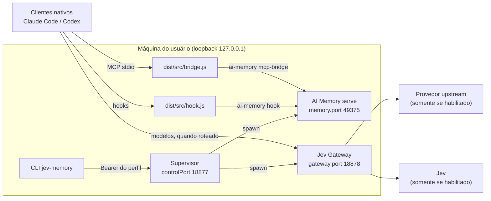
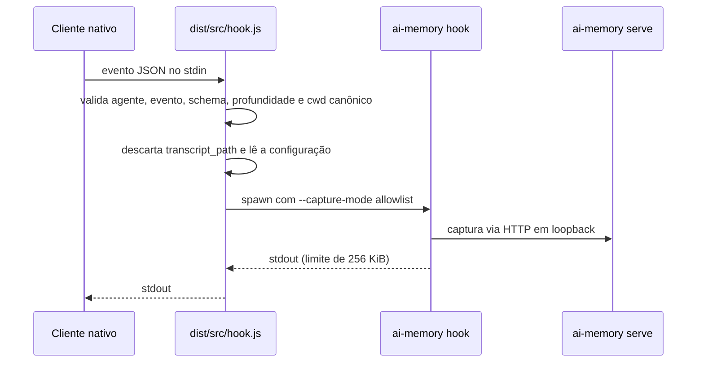
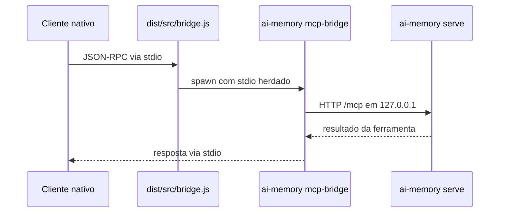

# Arquitetura

Propósito: descrever componentes, fronteiras de confiança, fluxos de processo, captura de hooks, consulta MCP e o layout de dados locais. Público: mantenedores e revisores de segurança. Data: 2026-10-21.

## Componentes

| Componente | Arquivos | Responsabilidade |
|---|---|---|
| CLI | `bin/jev-memory.mjs`, `src/cli.ts` | Comandos e seleção de perfil (`--profile`) |
| Ciclo de vida | `src/lifecycle.ts` | `init`, `start`, `stop`, `status`, `doctor` e `config` |
| Supervisor | `src/supervisor.ts` | Processo destacado que dona apenas os filhos que cria e expõe `/status` e `/stop` |
| Instalação | `src/install.ts` | Build versionado dos motores e ponteiro `current.json` |
| Atualização | `src/update.ts` | `git subtree pull --squash` com registro em `upstream.updates.json` |
| Configuração | `src/config.ts`, `config/default.json` | Schema estrito (zod) e caminhos locais validados |
| Hooks | `src/hook.ts` | Validação do payload nativo antes de chamar `ai-memory hook` |
| Bridge MCP | `src/bridge.ts` | Ponte stdio para o `ai-memory mcp-bridge` |
| Diagnóstico MCP | `src/mcp.ts` | Cliente de handshake e `memory_status` com allowlist de métodos e ferramentas |
| Clientes | `src/clients.ts` | Registro transacional em Claude, Codex e Codex Desktop |
| Lançamento | `src/launch.ts` | Executa Claude ou Codex com configuração específica do perfil |



## Fronteiras de confiança

1. **Conta do usuário e sistema de arquivos.** Todos os processos rodam sob a conta do usuário. A proteção de `.local/` depende das ACLs do NTFS, porque o Windows ignora os modos POSIX (`0600`).
2. **Loopback.** Supervisor, Gateway e AI Memory escutam em `127.0.0.1`. Outro processo da mesma conta pode tentar conectar; o bearer por perfil é a barreira.
3. **Entrada dos clientes nativos.** Hooks e MCP recebem dados que a suíte trata como não confiáveis. Payloads são validados antes de qualquer leitura de configuração.
4. **Conteúdo da memória.** Páginas e observações recuperadas são dados históricos, não instruções. A suíte não as executa; o risco de injeção permanece para o cliente e o operador (veja [threat-model](../security/threat-model.md)).
5. **Provedores externos.** Só existem se o Gateway estiver habilitado. Os hosts devem estar na allowlist e usar HTTPS (ou loopback numérico).
6. **Arquivos de cliente no workspace.** `.mcp.json`, `.codex/*` e `.claude/settings.local.json` são alterados somente com propriedade comprovada e backup.

## Processos e fluxo de inicialização

```mermaid
sequenceDiagram
  participant U as CLI
  participant S as Supervisor (destacado)
  participant M as ai-memory serve
  participant G as Gateway (node dist/index.js)
  U->>S: spawn de dist/src/supervisor.js
  loop até 45 s
    U->>S: GET /status com Bearer
  end
  S->>S: verifica que as portas estão livres
  S->>S: initMemory (somente em diretório novo)
  S->>M: spawn com --bind 127.0.0.1:memory.port
  S->>M: GET /healthz
  S->>G: spawn com env allowlist e chaves do ambiente
  S->>G: GET /health
  S-->>U: phase ready
  U->>S: POST /stop com Bearer
  S->>M: SIGTERM; SIGKILL após 6 s
  S->>G: SIGTERM; SIGKILL após 6 s
  S-->>U: {"stopping":true}, depois encerra
```

O `stop` da CLI nunca mata PIDs armazenados. Ele só pede parada ao supervisor autenticado.

## Captura por hook e consulta MCP





## Layout de dados

Tudo fica em `.local/`, que é ignorado pelo Git (`.gitignore`).

```text
.local/
  profiles/<perfil>/
    suite.json            configuração validada do perfil
    control-token         segredo do supervisor (não versionar; não entregue a clientes)
    router-token         chave de roteador: clientes nativos e Gateway (não versionar)
    logs/                 supervisor.log, memory.log, gateway.log
    memory/               dados do AI Memory (config.toml, auth-tokens/, wiki, SQLite)
    launch/               claude-mcp.json e claude-settings.json
  engines/
    current.json          ponteiro: memory {tree, binary} e gateway {tree, dir}
    ai-memory/<tree>/     ai-memory.exe por árvore Git, imutável
    jev-gateway/<tree>/   gateway compilado no lugar; .jev-suite-complete gravado por último
  cargo-target/  cargo-home/  npm-cache/  pnpm-store/  tmp/   caches e temporários
  evidence/               logs de build e instalação e evidências de validação
  installed.json          último resultado de `install`
```

Cada workspace de cliente tem, além disso, `<workspace>/.local/client-backups/` com os backups de registro. Layouts e formatos estão em [arquivos gerenciados](../api/managed-files.md).

## Portas padrão

| Serviço | Chave em `suite.json` | Padrão | Escuta |
|---|---|---|---|
| Supervisor (controle) | `controlPort` | 18877 | `127.0.0.1` |
| AI Memory | `memory.port` | 49375 | `127.0.0.1` |
| Jev Gateway | `gateway.port` | 18878 | `127.0.0.1` |

As três portas devem ser distintas e estar entre 1024 e 65535. Um perfil novo copia os padrões: sem alteração, colide com o perfil `default`.

## Decisões

As decisões aceitas estão em [docs/architecture/adr](adr/README.md). Em resumo: os motores são preservados e compilados a partir de commits fixados ([ADR 0001](adr/0001-engines-and-boundaries.md)); cada versão fica em diretório próprio ([ADR 0002](adr/0002-versioned-engine-installs.md)); o registro nos clientes é transacional ([ADR 0003](adr/0003-transactional-client-registration.md)); hooks têm fronteira e captura por allowlist ([ADR 0004](adr/0004-hook-boundary-and-capture-allowlist.md)); e nenhuma integração é tida como validada sem evidência ([ADR 0005](adr/0005-validation-evidence-policy.md)).
